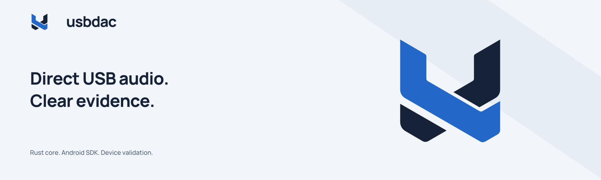
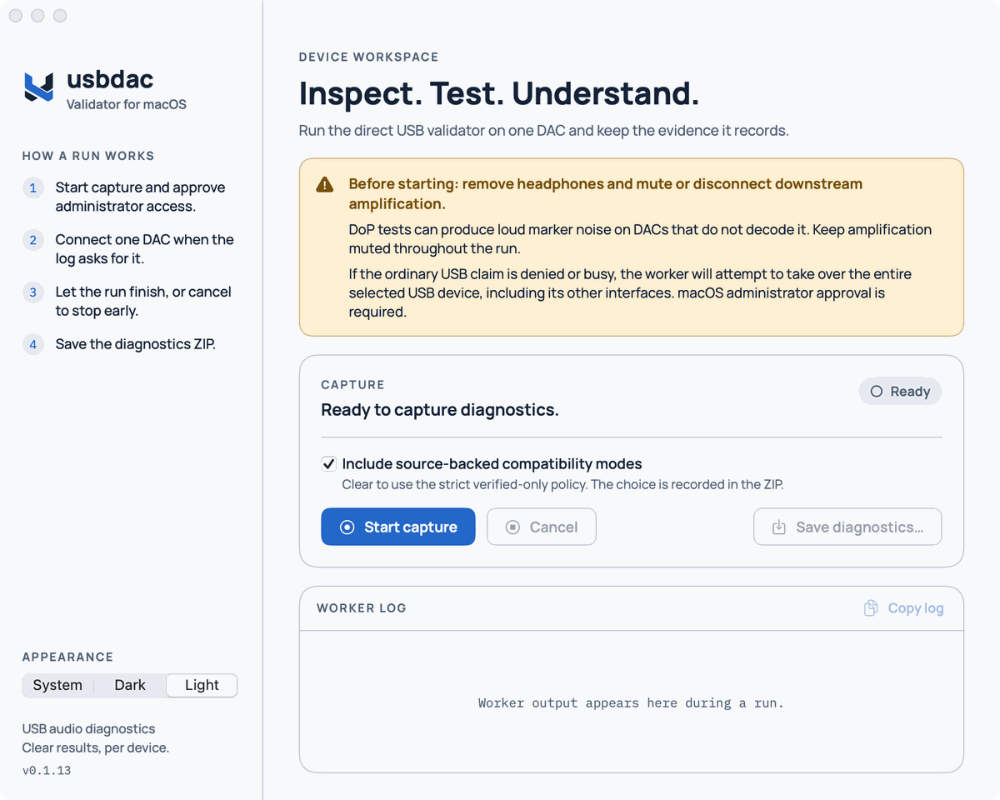
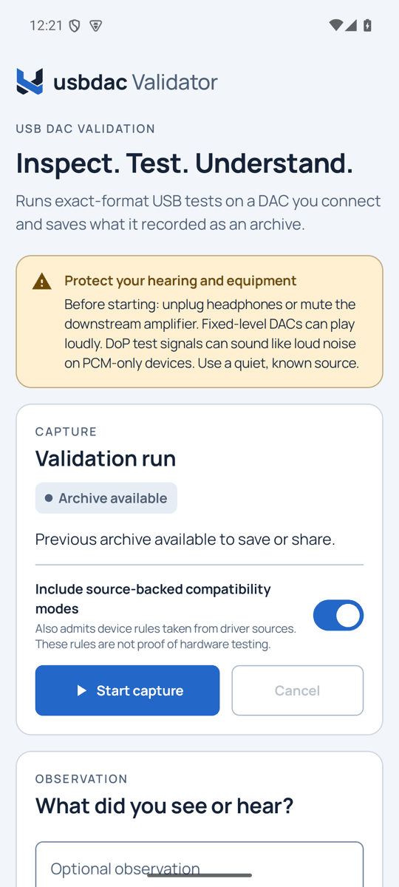

<p align="center">
  <picture>
    <source media="(prefers-color-scheme: dark)" srcset="branding/marketing/usbdac-readme-dark.svg">
    
  </picture>
</p>

<p align="center">
  <a href="https://github.com/johnneerdael/usbdac/releases/latest"></a>
  <a href="https://crates.io/crates/usbdac-core"></a>
  <a href="https://johnneerdael.github.io/usbdac/"></a>
  <a href="https://github.com/johnneerdael/usbdac/actions/workflows/ci.yml"></a>
  
  <a href="LICENSE"></a>
</p>

**usbdac** adds direct USB DAC playback to Android and Rust audio apps. It sends
decoded PCM, DoP or native DSD straight to the DAC over USB, bypassing Android's
mixer, follows the DAC's own clock, drives its hardware volume and tells your app
whether the stream is bit-perfect, with the reason when it is not.

One `OutputSelector` call gives an Android player a single PCM integration that
uses direct USB, Android-managed audio or AAudio exclusive output as the device
and permissions allow, and says which route it opened and what it could verify.

<p align="center">
  <a href="https://johnneerdael.github.io/usbdac/getting-started.html"><b>Quickstart</b></a> &nbsp;·&nbsp;
  <a href="https://johnneerdael.github.io/usbdac/"><b>SDK guide</b></a> &nbsp;·&nbsp;
  <a href="https://github.com/johnneerdael/usbdac/releases/latest"><b>Download</b></a> &nbsp;·&nbsp;
  <a href="https://johnneerdael.github.io/usbdac/evidence.html"><b>Evidence</b></a> &nbsp;·&nbsp;
  <a href="https://github.com/johnneerdael/usbdac/issues"><b>Report an issue</b></a>
</p>

## Pick your path

| You are building | Add | Start with |
|---|---|---|
| An Android player in Kotlin (Android 8.0+) | `dev.usbdac:usbdac` from GitHub Packages. The AAR bundles native code for all four Android ABIs. | [Android quickstart](https://johnneerdael.github.io/usbdac/getting-started.html) · [Kotlin guide](https://johnneerdael.github.io/usbdac/guide-kotlin.html) |
| A Media3 / ExoPlayer app | `dev.usbdac:usbdac-media3`, at the same version as the base artifact | [Media3 integration](https://johnneerdael.github.io/usbdac/media3.html) |
| A Rust engine on Android or Linux | [`usbdac-core` from crates.io](https://crates.io/crates/usbdac-core). Your app handles USB access and passes an open file descriptor. | [Rust guide](https://johnneerdael.github.io/usbdac/guide-rust.html) · [docs.rs](https://docs.rs/usbdac-core) |
| A test of your own DAC | The Android or Apple Silicon macOS validator from the [latest release](https://github.com/johnneerdael/usbdac/releases/latest) | [Validator design](docs/design/dac-validator.md) · [macOS notes](macos/validator/README.md) |

## Why usbdac

- **Bit-perfect, or the reason.** `is_bit_perfect()` combines the payload audit, clock verification and loss counters; `bit_perfect_blocker()` names what stands in the way.
- **Follows the DAC's clock.** Explicit feedback and compatible UAC2/UAC3 implicit feedback steer packet sizes; stale feedback clears the verdict instead of hiding it.
- **PCM, DoP and native DSD.** PCM 16/24/32-bit in the DAC's subslot size, DoP carriers, legacy and standard UAC3 native DSD layouts.
- **Safe start-up volume.** The DAC's hardware volume is lowered to at most -40 dB before the first sample and handed back on close.
- **One interface, three routes.** Direct USB, Android-managed `AudioTrack` and AAudio exclusive behind `PcmOutput`, chosen by `OutputSelector`.
- **UAC 1, 2 and 3.** Including BADD, PCM capture and duplex, channel layouts, verified clock selection and standard routing controls.
- **Honest conversion.** Resampling, bit-depth and mono-to-stereo are always labelled, so a limited DAC still plays and is plainly marked as not bit-perfect.

## Measured on real hardware

On 27 November 2026 the Android validator ran its exact-format playback matrix on
four DACs with a OnePlus 15. Every case passed USB delivery bit-perfect, with no
underrun, lost frame, short packet or transfer timeout.

| DAC | VID:PID | Passed | PCM | Native DSD |
|---|---|---|---|---|
| iBasso DC04U | `0661:0883` | 44 of 44 | 44.1 to 768 kHz | DSD64 to DSD512 |
| SMSL USB AUDIO | `152a:85dd` | 34 of 34 | 44.1 to 768 kHz | DSD64 to DSD512 |
| Hidizs AP80 Pro-X | `c502:0072` | 34 of 34 | 32 to 384 kHz | DSD64 to DSD256 |
| Schiit Unison Modius E | `30be:101a` | 20 of 20 | 44.1 to 192 kHz | Not admitted |

These are USB transport results. No analog output or DoP decoder lock was
observed, and native DSD on the DC04U and SMSL used the source-backed quirk
policy. Earlier builds also played PCM through Flick and the SDK sample. The
[hardware status](docs/sdk/evidence.md#hardware-status) has the formats and paths,
the [release validation scope](docs/sdk/evidence.md#release-validation-scope) what
each release checks, and the [implementation ledger](docs/design/alsa-parity.md)
what is implemented but not yet run on a device.

**Status: 0.1.** Release preparation adds software validation and PCM playback
to a virtual QEMU USB audio device, not physical streaming checks. Additional
models are tracked in [device compatibility candidates](docs/design/device-compatibility-candidates.md).
For in-app support captures, see [collecting a USB playback support report](docs/sdk/support-diagnostics.md).

## Validators

Each release from 0.1.11 on includes an **Android validator APK** and an
**Apple Silicon macOS validator ZIP**, built from the same commit as the
library. Start a capture, connect one DAC, and the app runs the direct USB
format tests and saves a report ZIP with device details, test outcomes and
debug logs. The APK is signed with the CI debug key; the macOS app is ad hoc
signed and not notarized. Remove headphones and mute the amplifier first.

<table>
  <tr>
    <td width="68%"><picture><source media="(prefers-color-scheme: dark)" srcset="docs/site/screens/macos-validator-dark.png"></picture><br><sub><b>macOS.</b> One window: the safety checks, the capture and the worker log.</sub></td>
    <td width="32%"><picture><source media="(prefers-color-scheme: dark)" srcset="docs/site/screens/android-validator-dark.png"></picture><br><sub><b>Android.</b> Material 3, System, Dark or Light.</sub></td>
  </tr>
</table>

## Learn more

The [SDK guide](https://johnneerdael.github.io/usbdac/) has the developer
documentation: [design decisions](https://johnneerdael.github.io/usbdac/decisions.html)
(each compared with what Flick, Mornye and BitChord do, with the evidence and
public references), the [architecture](https://johnneerdael.github.io/usbdac/architecture.html),
an [integration guide](https://johnneerdael.github.io/usbdac/integration.html),
[troubleshooting](https://johnneerdael.github.io/usbdac/troubleshooting.html) and the
[evidence and status](https://johnneerdael.github.io/usbdac/evidence.html) page.
The Rust API, JNI contract, JSON schemas and sample layouts are in [docs/API.md](docs/API.md).

## Where it came from, and what changed

usbdac started from the USB DAC driver of the [Flick](https://github.com/moss-apps/Flick)
music player. It is no longer that driver. The code was taken out of the app,
given a public API, and improved in ways Flick's own driver has not been.
[What usbdac improves](docs/sdk/improvements.md) explains each change twice:
technically, and in plain terms. Several of the changes came from studying how
two other open-source players, Mornye and BitChord, behave with the same DACs.
No code from either was used.

<details>
<summary><b>Everything usbdac changed, area by area</b></summary>

| Area | What usbdac adds | In plain terms |
|---|---|---|
| Clock handling | Resolves selectors and multipliers, verifies rates, and restores owned changes | A compatible alternate clock can serve a rate the current clock cannot |
| USB feedback | Uses the newest valid explicit rate report and supports compatible UAC2 and UAC3 implicit feedback | Playback can follow the device clock through a dedicated rate endpoint or a matching input stream |
| Transfer queue | About 16 ms and eight transfers by default, with bounded adaptive depth | Tunable buffering; the packet cap follows a stall observed on one phone and DAC |
| Fault handling | Uses a bounded loss budget and conservative accounting for failed transfers | Brief recoverable USB faults can continue with a reported loss |
| Buffering | 250 ms reserve that shrinks while software volume is active | More protection against gaps without slower controls |
| Pause and seek | Pause holds the audio and sends silence; flush cancels what is on the bus | Previously submitted audio may still play; timing and acoustic output are not measured |
| Position | Counted from completed transfers | A transport position estimate, not an acoustic measurement |
| Start-up safety | Volume lowered to at most -40 dB before the first sample; no volume control means no playback unless allowed | Plugging in a DAC cannot blast your ears |
| Volume | Useful slider range, latest-wins writes, works without a stream, key and system-panel helpers, original level handed back | The volume behaves the way phone volume does, and other apps get the DAC back as it was |
| Power | Stream released after a long pause | Less battery used while paused |
| Honesty | Bit-perfect flag with a named reason when false; chosen clock and pacing reported | An indicator that goes out when the sound is compromised, and says why |
| Outputs | Direct USB, Android-managed, and AAudio exclusive behind one interface | One integration serves phones with dongles and players with built-in DACs |
| Capture and duplex | Explicit PCM input APIs, shared endpoint ownership, channel layouts and separate loss/overrun reporting | Record input alone or alongside playback without stalling USB pacing |
| Hardware routing | Session-bound USB Audio Class controls with readback and rollback | Expose the controls the device can prove it supports |
| Output choice | An `OutputSelector` that detects the DAC, permission, route and what the platform grants, and returns one ready output with the reason and the guarantee | The app asks for the best way to play and is told what it got and why |
| Conversion | Resampling, bit-depth and mono-to-stereo, always labelled. `OutputSelector` uses it by default when the DAC cannot run a request; the direct stream never converts on its own | A file still plays on a limited DAC, and is plainly marked as not bit-perfect |
| Packaging | Rust core, Kotlin API, sample app, tests, published builds | A dependency and a few dozen lines instead of writing a USB driver |

</details>

## Technical reference

<details>
<summary><b>What it does</b>: formats, buffering, pacing, volume, rates, conversion and events</summary>

The shared USB Audio implementation includes UAC3 and BADD, PCM capture and
duplex, channel layouts, verified clock selection and restoration, standard
routing controls and guarded device-specific controls. Native DSD uses a
standard UAC3 layout or a resolved legacy profile. DoP capability describes
a feasible PCM carrier; marker decoding still needs device evidence.

- Formats: PCM 16/24/32-bit in the subslot size the DAC advertises, DoP
  (carrier up to what the DAC runs), native DSD (legacy 1-, 2- or 4-byte
  profiles and standard 8-byte UAC3 words). Legacy byte and bit order are
  resolved per alternate, device and applicable firmware.
- Output: a ring buffer (250 ms target, 500 ms capacity by default) feeds eight
  isochronous transfers initially, targeting about 16 ms. Adaptive depth (on by
  default) adds two transfers after a loss and removes one after 30 s without
  loss. It stops at 16 transfers, 64 ms or 255 packets in flight, whichever
  comes first: with the default 2 ms transfers that is 32 ms, or 30 ms at a
  125 µs service interval. Explicit custom geometry fixes the depth.
  Explicit rate reports and
  implicit capture packet counts steer asynchronous playback packet sizes.
- Flush: `flush()` drops the ring and cancels what is already on the bus (not
  counted as played, lost or an underrun). Cancellation is asynchronous and
  already submitted audio and downstream buffering affect when a seek is heard.
- Reporting: played frames and latency counted on completed transfers, lost
  frames (timed-out and short transfers) latched, an audit of the wire payload,
  and `is_bit_perfect()` combining them with the clock verification, with
  `bit_perfect_blocker()` saying what stands in the way.
- Pacing: explicit feedback uses the newest valid report in each poll batch
  and checks that the resulting packet fits. A short report gap can recover
  while playback holds the last good rate. Stale feedback clears the
  bit-perfect verdict, and a persistent outage ends the stream. Implicit
  feedback uses frame counts from a compatible UAC2 or UAC3 IN stream that
  shares the playback clock, rate and service interval. An otherwise valid asynchronous
  full-speed UAC1 PCM route without a declared feedback pipe can use nominal
  pacing by default; the explicit `allow_unsynchronized_async` option permits
  a broader fallback. Either is unverified.
  See [clock and pacing](docs/sdk/decisions-clock.md#feedback).
- Volume: the Feature Unit's volume and mute, with read-back verification, a dB
  and a 0..1 view, the level the DAC had before, and a hand-back on close. The
  volume is lowered to at most -40 dB when the DAC opens (never raising a
  channel, verified by reading it back), and a DAC without a usable hardware
  volume refuses to stream unless the host allows a fixed level.
- Rates: `StreamRequest` defaults to `RatePolicy::Exact`, which refuses a rate
  the DAC cannot run. `RatePolicy::NearestSupported` picks another rate in
  this order: the highest supported integer divisor of the request, the
  highest lower rate in the same family, the highest other lower rate, then
  the lowest higher rate. 192 kHz on a DAC with 96 and 48 kHz gives 96 kHz.
  Lower-first ranking can cost bandwidth: an 88.2 kHz source on a DAC with
  only 44.1 and 176.4 kHz gets 44.1 kHz. The host then resamples, and the stream
  is not bit-perfect.
- Conversion helpers (`usbdac_core::convert`): a polyphase windowed-sinc
  resampler, integer widening and narrowing with TPDF dither, float and mono-to-stereo,
  planned and classified (`None`, `BitExact`, `Lossless`, `Lossy`) so a host can play a
  rate the DAC refuses and say honestly that it is not bit-perfect. The direct path never
  calls them by itself (`docs/API.md` section 14). On Android, `OutputPolicy` enables
  them by default (`allowConversion` and `allowWidening`). Resampling applies −3.5 dB of
  headroom, which reduces clipping but does not prevent it, so clipped samples are counted.
  Unpacking DoP to PCM also needs `allowDopPcmConversion`, which is on by default
  since 0.1.16; set it to `false` to refuse it.
- Events through one library thread: state changes, underruns, lost frames,
  bit-perfect changes, volume changes, stale feedback, errors, device loss.

Besides direct USB, the library carries two outputs that go through Android:
an `AudioTrack`-based one that asks Android 14 and later for its bit-perfect
mode, and an AAudio exclusive-mode stream for devices with an internal DAC.

</details>

<details>
<summary><b>Limits</b></summary>

- One owner per physical attachment; distinct attachments can have independent owners. A second owner for the same attachment is refused.
- `Dac::open` takes a usbfs file descriptor and works on Linux and Android
  only. On macOS, `Dac::open_darwin` drives a libusb attachment found by
  `darwin_discovery`. The Apple Silicon validator uses this path, and no
  macOS hardware result is recorded yet. On other hosts everything compiles
  and the logic tests run, but opening a DAC returns `Error::PlatformUnsupported`.
- UAC 1.0/2.0/3.0 playback and PCM capture, including BADD profiles.
  Capture and duplex require explicit input APIs and USB claims.
- Standard routing and supported vendor controls depend on the active
  topology and verified device capabilities. Additional devices need
  evidence-backed compatibility work.
- The host owns USB permission, `claimInterface` and the file descriptor.

</details>

<details>
<summary><b>Minimal Rust example</b></summary>

Add the core crate with `cargo add usbdac-core@0.1.19`. The example logs
through the `log` crate.

```rust
use std::sync::Arc;
use usbdac_core::{Dac, DacConfig, DacEvent, DeviceInfo, StreamRequest};

fn play(fd: i32) -> usbdac_core::Result<()> {
    // `fd` is UsbDeviceConnection.getFileDescriptor(); the host has already
    // claimed the AudioControl and playback AudioStreaming interfaces.
    let info = DeviceInfo::new(0x2fc6, 0xf09a, "Some DAC").with_claimed_interfaces(vec![0u8, 1, 2]);
    let dac = Dac::open(fd, info, DacConfig::default())?;

    if let Some(volume) = dac.volume() {
        volume.set_fraction(0.5)?;                      // the DAC's own volume
    }

    let format = dac.negotiate(&StreamRequest::pcm(44_100, 2, 16))?;
    let stream = dac.open_stream(&format, Arc::new(|event: DacEvent| {
        log::info!("{event:?}");                        // runs on the library's event thread
    }))?;

    // Wire-layout bytes: 16-bit stereo here, 4 bytes per frame. Keep the ring
    // near its target by writing what `writable_bytes()` asks for.
    let silence = vec![0u8; stream.writable_bytes()];
    let taken = stream.write(&silence)?;                // never blocks; a short count means "full"
    log::info!("queued {taken} bytes, bit-perfect: {}", stream.is_bit_perfect());

    stream.drain()?;                                    // no more audio: play the tail out
    while !stream.is_drained() {
        std::thread::sleep(std::time::Duration::from_millis(10));
    }
    stream.close()?;
    dac.close()
}
```

`crates/usbdac-core/examples/pull_adapter.rs` shows a host with a render
callback driving `write()` from its own thread, with pause, seek and position.
The sample layout of each encoding, the event codes, the JSON schemas and the
threading rules are in [docs/API.md](docs/API.md).

</details>

<details>
<summary><b>Repository layout</b></summary>

```text
crates/usbdac-core/   the driver (Rust): no JNI, no application types
crates/usbdac-jni/    libusbdac.so, the JNI bindings
crates/usbdac-validator/ the shared physical DAC test suite and report writer
android/usbdac/       the Android library (AAR, Kotlin, package dev.usbdac)
android/usbdac-media3/ optional Media3 AudioSink integration
android/sample/       a small app that exercises every feature
android/validator/    the Android DAC validator app
macos/validator/      the Apple Silicon macOS DAC validator app
fuzz/                 cargo-fuzz target for the descriptor, clock, feedback and control-reply parsers
docs/sdk/             the SDK guide (published to the site above)
docs/site/            the site's stylesheet, script and landing section
docs/API.md           the Rust API, JNI contract, JSON schemas, sample layouts
branding/             the usbdac brand kit: logos, artwork, icons, fonts and tokens
```

The optional `dev.usbdac:usbdac-media3` artifact integrates the SDK with [Media3](docs/sdk/media3.md); use the same version as the base Android artifact.

</details>

<details>
<summary><b>Build from source</b></summary>

```sh
# host: build and test everything that does not need a DAC
cargo test --workspace

# Android (needs the NDK; cargo-ndk sets the C toolchain libusb1-sys needs)
export ANDROID_NDK_HOME=$HOME/Library/Android/sdk/ndk/28.2.13676358
cargo ndk -t arm64-v8a check --workspace
cargo ndk -t arm64-v8a build -p usbdac-jni --release     # target/aarch64-linux-android/release/libusbdac.so
```

Plain `cargo check --target aarch64-linux-android` also works once the NDK's
clang is reachable, because libusb is compiled from source:

```sh
NDKBIN=$ANDROID_NDK_HOME/toolchains/llvm/prebuilt/darwin-x86_64/bin   # linux-x86_64 on Linux
PATH=$NDKBIN:$PATH CC_aarch64_linux_android=aarch64-linux-android26-clang \
  AR_aarch64_linux_android=llvm-ar cargo check --workspace --target aarch64-linux-android
```

Add `-t armeabi-v7a`, `x86_64`, ... for other ABIs. `usbdac-core` depends on
`rusb`, `libusb1-sys`, `parking_lot`, `once_cell`, `crossbeam-channel`, `log`,
`libc`, `serde`, `serde_json`, `base64` and `flate2` (`base64` and `flate2`
decode Focusrite FCP data; `serde` and `serde_json` serialize error codes and
macOS discovery evidence); the JNI crate adds `jni` and, on Android,
`android_logger`, and links `usbdac-validator` only with its `validator`
feature.

The validators build with `./gradlew :validator:assembleDebug` (from `android/`)
and `macos/validator/build.sh`.

</details>

<details>
<summary><b>How releases are made</b></summary>

Library changes merged to `main` start the Release workflow. It advances the
patch version, builds and tests a versioned commit, publishes the Rust crate
and the `usbdac` and `usbdac-media3` AARs, and creates the GitHub Release with its downloads. A merge
that declares a higher version can select the next minor or major release.
For releases from sources containing the validator, the downloads also include
a versioned Android validator APK and Apple Silicon macOS validator ZIP built
from that same commit. The APK uses the CI debug signing key; the macOS app is
ad hoc signed and not notarized. Both are included in `SHA256SUMS.txt`.
Documentation-only changes deploy through the Docs workflow.

Use **Actions → Release → Run workflow** to build an explicit version, or
rerun the original Actions run to retry an automatic release from its
reserved commit.

</details>

## License

MIT. Copyright (c) 2026 Flick Player Contributors and usbdac contributors. See
[LICENSE](LICENSE) and [NOTICE](NOTICE). The brand fonts in `branding/fonts`
(Manrope and IBM Plex Mono) are under the SIL Open Font License; their license
files sit next to them.
